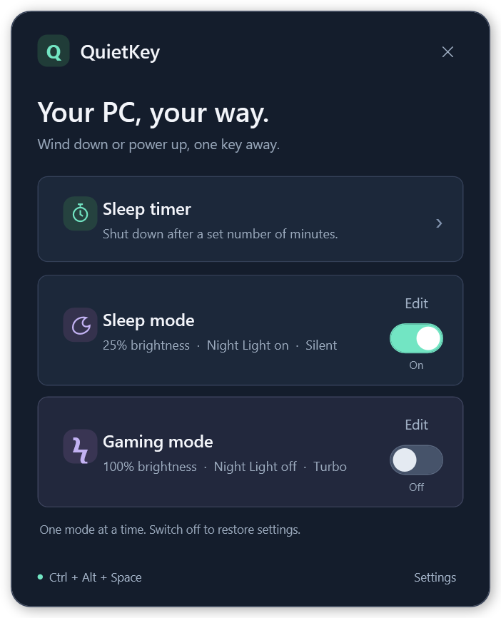

<div align="center">

# ⚡ QuietKey

**Wind down. Power up. One shortcut.**

A tiny Windows tray app with big switch energy.

[**Download for Windows**](https://github.com/ErphanRajai/QuietKey/releases/latest) · [Guide](docs/GUIDE.md) · [Suggest a feature](https://github.com/ErphanRajai/QuietKey/issues)



</div>

## Your PC, your way

| Shortcut | What it does |
| --- | --- |
| 🌙 Sleep mode | Dim the screen, enable Night Light, go Silent, save power. |
| ⚡ Gaming mode | Turbo fans, best performance, Game Mode, full brightness. |
| ⏱️ Sleep timer | Pick the minutes. Schedule a shutdown. Cancel anytime. |

Slide right to enable a mode, left to restore your settings. Both profiles are editable. Sleep mode keeps the PC awake; Gaming requires AC power. ASUS fan presets need a supported ASUS driver.

## Get going

1. Download **QuietKey.Setup.exe** from [Releases](https://github.com/ErphanRajai/QuietKey/releases/latest) and run it.
2. Press **Ctrl + Alt + Space**. You're in.

Starts with Windows. Lives in the tray. No console windows. Uninstall through Windows Settings.

## Build it

C# + WPF · Windows 10/11 x64 · .NET Framework 4.8. No extra SDK or NuGet dependencies.

```powershell
.\build.ps1 -Test -Package
```

## What should we add next?

Got a shortcut you wish existed? More profiles? Support for your laptop? [Open an issue](https://github.com/ErphanRajai/QuietKey/issues)—recommendations, bugs, and wild ideas are welcome.
